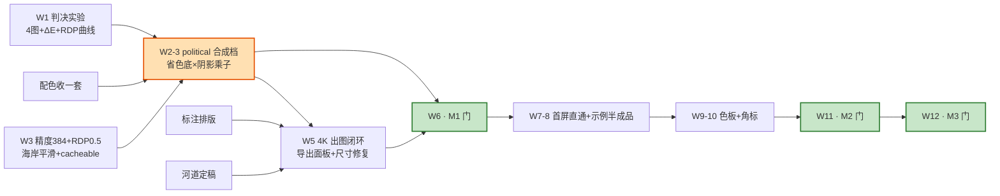

# 司天 · 3 个月交付方案（2026-11-09）

> **三条已定约束**：① 最终要**给别人用**；② 观感锚点 = **EU4 / CK3 政治地图**；③ **3 个月内见成品**。
> **这份文件取代**：`PLAN_AUDIT_20261030`（阶段门序）、`FREEZE_20261108`（冻结页，仅作诊断证据保留）。
> **基线**：`fe1ee81` / 0.5.2 / 166 CDP + 117 Node + 22 drill / `src` 123,854 行 / 354 文件。

---

## 〇、一页结论

1. **架构不是瓶颈 —— 这条要当场认下来。** 上一版规划把"渲染层接口化"当成美术的唯一解锁前置，排了 2–3 周。实测：注册表早已落地（`utils/scenarioLayerRegistry.js`，124 行，已注册 7 层），`ScenarioMap.vue` 从 14,206 行降到 **6,117 行**（判据 ≤8,500），文件内 `draw*` 从 28 个降到 **3 个**，`PlanetMap.vue` 内 **0 个**。**这 2–3 周是凭空多出来的，收回。**
2. **"不可用"的根因有两个，不是一个。**
   - **海岸形态**：导入时 `azgaar-parser.js:290 simplifyRing(raw, 1.2)` 把源点砍掉 **93–95%**（415 省：1,747/25,918；`__real_desite.map`：2,053/37,958）。4K 下海岸段长中位 **14.5px**、最长 **85.9px**。→ 改一个常数，**1–2 天**。
   - **一省两色 / 相邻缝隙 / 两套几何**：`ScenarioMap.vue:3937 POLITICAL_WASH = 0.42`，且 `4510` 是 `politicalWash: relief ? 0.42 : 1` —— **默认就开**。省色只有 42% 不透明度，压在双线性插值的地形栅格上。这不是带宽问题，是**每个省身整面的混合**。→ 要动合成方式，**不是参数**。
3. **"验证体系证明的不是用户要的东西"是这次最贵的教训。** 过去量"功能在不在"，用户量"图敢不敢用"。本方案把"可用"改成 **8 条能在成品图上被第三者指认的判据**，并且**像素基线退出门禁**（它只能证明"没变坏"，永远证明不了"够好了"；已重立 41 次，吃掉 30–40 次观感提交的迭代速度）。
4. **只救剧本侧。** 行星侧/区域侧本期冻结、**不删一行代码**、界面加角标说明。三线并行是 359 次提交换来的实证失败。
5. **W2 不问用户做选择题。** 原本准备让用户在"保 EU4 承诺 / 降标 / 绑观察尺度"里三选一；根因定位后**不需要降标**，改为一句变更告知。**少问用户一次降标，是这轮最值钱的结果。**

---

## 一、现状判定（重新校准）

| 项 | 读数 | 复核命令 |
|---|---|---|
| 源码 | **123,854 行 / 354 文件**（vue 46,380 + js 77,474） | `find src \( -name '*.vue' -o -name '*.js' \) -print0 \| xargs -0 cat \| wc -l` |
| 最大文件 | `ScenarioMap.vue` **6,117**（闸门 ≤6,120，**只剩 3 行余量**） | `wc -l src/renderer/src/components/ScenarioMap.vue` |
| 测试 | 166 CDP / 117 Node / 22 drill | `ls scripts/tests/cases/test_*.py \| wc -l` |
| 文档 | 117 份 md | `find docs -name '*.md' \| wc -l` |
| 像素基线 | **119 json + 157 png（38 张孤儿）** = 308 文件 | `ls build/pixel-baseline/ \| wc -l` |
| 视觉套件 | 代码 **5 个 STEPS**，文档写 6 步 | `grep -n 'STEPS =' scripts/tests/drill_visual_suite.py` |
| 环境 | 系统 Python **3.14.7**，**Pillow 有 / numpy 缺** | `python -c "import PIL, numpy"` |

> ⚠️ 尺子坑：`find ... | xargs wc -l | tail -1` 只取最后一批的 total，会量出 52,190 的假数。必须 `cat | wc -l`。
> ⚠️ 基线目录里 38 张 png 是无人清理的孤儿帧 —— 这个目录本身已经不可信，不能当门禁用。

---

## 二、交付物定义：8 条判据

> **总判据**：一张 3840px 宽的 4K PNG，第三者不看说明、只拿图，能在 10 分钟内指认“哪块是谁的、边界在哪、界上写的什么”，并愿意贴进自己的文档。
> **元判据（所有判据的前提）**：**任何判据必须能在图上被第三者指出来。指不出来就作废，不许靠"整体看"补。**
> **判据自查（新增，因为这轮连续被推翻三条判据）**：每条判据必须同时给出 ① 一个**已知不过的负样本**（例：U8 的负样本 = 现状折点 1,747 / 中位 14.5px），② 一个**负向探针**（故意把某个数改坏，判据必须红）。**给不出负样本的判据不许上打分卡。**
> **目标 vs 门（新增）**：凡写"要满足 X"，必须标明它是**门**（不过不发版）还是**目标**（做不到只记录）。**目标不许混进门禁。** 本轮已因此撤回两条：`12MB`（现 7.81MB，按 bench 项目算出来的，不成立）、`tileCount ≥ 1,000`（结构性天花板 678）。
> **判据必须写明污染源**：凡是量复现性的判据（U7 sha256 等），必须写明它**测不出**什么。例：`exportPNG` 把世界坐标变换下沉到层里 → 导出拿视口分辨率位图并拉伸，而两次 sha 仍一致 → **U7 全绿但图是糊的**。
> 为什么加这三条：这轮我们造的判据（U3 混色带 3px / 整帧 ≤16.7ms / U5b ΔE≤10 / U8 的 120px / 12MB 体积门）**五条全部作废**——要么量不到，要么现状本来就过。8 条判据本身也要被验伪一次，否则三周后会拿到"8 条全绿但用户仍判不可用"，和 166 用例全绿时一模一样。

| # | 判据 | 判定底图 | 级别 | 现状 |
|---|---|---|---|---|
| **U1** | 相邻势力省之间无宽度 ≥2px 的纸色缝隙；同一像素无两层省色叠加（偏离两色中点 ΔE >8 算叠） | relief-off | Must | ❌ 未测 |
| **U2** | 相邻势力主色 **ΔE00 ≥ 20**；势力主色与无主省纸色 **ΔE00 ≥ 15**（**报告必须标算法**：探针用 ΔE76、门禁用 ΔE00，两者对同色差可差约 2×，不标等于不可比） | relief-off | Must | ❌ 未测（色板用户自选，零约束） |
| **U3** | 省界 1–2px；势力边界 ≥2× 省界；海岸线 ≤省界线宽 | relief-off | Must | ⚠️ 代码有三档线宽，成图无判据 |
| **U4** | 注记外接矩形不相交；无文字被省界/图幅切断；文字与紧邻底色对比 ≥4.5:1 | relief-off | Must | ⚠️ 只判布局函数，不判成图 |
| **U5a** | **relief-off 下**同省内（剥 1px 抗锯齿带）亮度极差 ≤12、色相偏移 ≤6° | relief-off | Must | ❌ 必红（42% 水洗） |
| **U5b** | **relief-on 下**同省亮度极差 ≤18；且 **3 个已知省探针**（离省界 50px 的 5×5 均值）**ΔE(on,off) ≤ 5** | relief-on | Must | ❌ 未测（**阈值若定 10，等于现状 9.86，落地即绿 —— 空判据**） |
| **U6** | 陆地无孤立河段（两端都不接水体/其他河）；沿河无断点 | relief-on | Should | ⚠️ 数据层有，成图层无 |
| **U7** | 导出图无交互残留（选中描边/悬停/网格/浮层）；宽 ≥3840px；同会话连导两次 sha256 一致 | — | Must | ❌ 现导出宽 2560（见 §四-3） |
| **U8** | ① **绘制后**折线 **中位 ≤ 6px**（现状 14.6）、**p90 ≤ 17px**（现状 30.2）；② **存储**折点 3,000 ≤ N ≤ 8,000；③ max 与 p99 只记录、不设阈值；④ **不设人工判断**（"看着自然吗"不是判据） | 整幅档 | Must | ❌ 现必红 |
| | eps 0.3 实测 **3.9 / 10.5 / 5,965 点** → 余量 35%，不是压线过。曾有两版（p99≤10、长度占比≤5%）都因"基线没量"被撤回；**没量过的数不许上卡**。 | | | |
| **U9** | **打开项目 ≤ 5s**：从 `openProject` 调用到 `rm.items.length>0 && canvas` 就绪。分段记录（读文件 / 解析 / 烘焙 / 首帧），任一段占比 >60% 单独记账 | — | **Must** | ⚠️ **未知数**：`BAKE_BASE_WIDTH = 4096` 冷启动注释写 8–9 秒。若属实，这是陌生人旅程第 4 步的硬卡点，**比海岸线粗不粗严重得多** —— 用户在这一步直接关软件，走不到判据现场 |
| | 🔴 **①判绘制后、②判存储，不能都判绘制后**：Chaikin×2 能把 1,747 点磨成约 7,000，若 ② 也按绘制后计，它会**自动通过**——而它本意正是抓"用平滑顶替加点"。一句能骗、一句不能，必须分开。 | | | |
| | 🔴 **门不许设在余量只有 0.9% 的地方**：曾考虑 p99 ≤20px，但唯一达标档是 eps 0.2 / 7,931 点，占 8,000 上限的 **99.1%**，换一份 `.map` 或多一个湖环就破。把门钉在那儿，下一个人一定会去放宽上限 —— 那条路更坏。 | | | |
| | **取消 p99 与 max**：两者都有平台（p99 22–23px、max 32.7/59.9px 随环集变），因为混进了"几何上本来就直"的岸段（陆地切边、图幅边界）——那不是简化造成的，量它等于量源数据。**中位/p90 是唯一只反映"有曲率岸段加没加点"的干净统计量。** | | | |
| | **环集钉死**：`azgaar-parser.js` 抓 25 条 `feature_N`，经 `:286 isLandFeature` 过滤后**只有 20 条**会被画成海岸线（海/湖环不算）。**换环集量出的数一律不收**，环集与 sha256 一起进 fixtures。 | | | |
| | **eps 走阶梯，不预拍**：0.5 → 0.3 → 0.2，取第一个达标档，上限 8,000 点。**四档全不达标时不降判据**，报"本判据在 8,000 点内不可达"，由主理人改判据并写明理由 —— 这是唯一出口。 | | | |

**U5a/U5b 必须拆开**：只判 relief-on 会被"干脆永远关掉浮雕"绕过去；只判 relief-off 则测不到"省色被底图吃掉"。
**U8 豁免**：仅整幅/适屏档判定，放大档（>1.5×）不判 —— EU4 的省界放大看同样是折线，它的"细"来自海岸带分层而不是顶点数。

### 判据怎么用（这是与过去最大的差别）

| 过去 | 现在 |
|---|---|
| 每次改动重立像素基线 + 跑 166 用例 | 改完存一张快照，跑 U5a + U7 两条最便宜的 |
| 判据读 store / DOM（`eval_json`） | **判据只准读产物**：1 张 PNG + 1 个 SVG，禁止读代码状态 |
| 全绿 = 可发 | 全绿只是入场券；**发版要人眼签字** |
| 图变了没人知道为什么 | 图变了但 `WHY.md` 写不出原因 → **判 P0** |

---

## 三、MVP 范围

### 做（剧本侧，12 周）

| 序 | 事项 | 判据 |
|---|---|---|
| 1 | W1 判决实验：4 张 3840px 图（relief-off/on × 示例 72 省 / 415 省副本）+ ΔE 表 + RDP 曲线 | 1 小时内出结论，出口是这张卡，不是"再调一轮" |
| 2 | `cacheable` 生效 + 19 处直调登记进注册表 | 逐像素一致 + 166 全绿；涂归属松手/撤销只重画脏层 |
| 3 | **political 合成档**：省色不透明直填 → 阴影乘子 multiply → 一张离屏位图 → 矢量省界留最上层 | 政治档截图 vs EU4 参考；帧时 ≤16.7ms |
| 4 | 配色体系收成一套（4 条色带 + 13 群系色 → 1 套） | 同机位对比图 |
| 5 | 地形精度 192 → **384** | `test_terrain_params` 全绿；生成时间与体积出数 |
| 6 | RDP 容差 1.2 → **0.5** + 面状海岸接 `smoothPolyline` + 海岸层进 `cacheable`（同批） | U8 过；帧时不退化 |
| 7 | 标注排版（衬线 / 沿形 / 描边） | U4 过 + 同机位对比图 |
| 8 | 4K 出图闭环 + 导出面板 + 导出前清交互残留 | U7 过；`FREEZE §七` 那句话 |
| 9 | 首屏直通（世界选择页 hero）+ 示例项目做成"已画完 70% 半成品" + 引导改任务式 | 陌生人 12 步 → 3 步走到图 |
| 10 | 色板可区分度（默认色委派 + 撞色提示，不阻断） | U2 过 |
| 11 | 行星/区域"本期不保证出图质量"角标 | 进入前能看见 |

### 不做（本期明确出局）

- **行星侧 / 区域侧的一切绘制改动**（`PlanetMap` 4,568 / `AreaMap` 2,641 / `InteriorView` 1,919 行）。"行星绘制大修"**只立项写判据，不施工**——判据写成"M3 之后的第一张卡"。
- **隐藏入口**（代码不动，收进“实验功能”或降权）：3D 观景、建筑内部视图、外交关系面板、资料笔记绑定 + 读料桥阅读器/全库搜索/跳转、星域生成器参数面板、Tiled 导入、AI 剧本草案 / AI 翻译官。
- **冻结不修**：星域 φ 软融合与航道 LOD、气候/温度/降水档观感（只保证政治档）、多边形湖面、侵蚀层。
- **明确不做**：设定库视图、演变视频导出、自动更新、便携 zip、mac / linux。
- **不做内嵌字体**（已拍板：地名是自造词，静态子集必缺字）。

---

## 四、技术路线

### 1. 渲染：离屏合成，不是索引位图

**结论**：`political` 档 = **逐省 fill（不透明，无 wash）→ 阴影场 multiply → 一张离屏位图 → 矢量省界留最上层**，`cacheable:true`，缓存在 `createRasterCache()` 里。

```
① 逐省 Path2D fill 到离屏 canvas（省色不透明，复用 provincePathFor）
② shade 场（buildShadeMap 已有）× 双线性放大 → 灰度乘子
③ ①×②  globalCompositeOperation='multiply'
④ 主画布 drawImage 一次；省界仍是最上层矢量细线
```

为什么这样对：EU4 的地形只贡献**明暗**，政治色是**基色**。乘一个灰度乘子不会产生中间色泥；而 `globalAlpha=0.42` 叠两套几何，边缘永远对不齐——`heightmapRaster.js:689` 的注释自己承认“高度图的陆格边界与矢量海岸线不是同一条（相差可达一格）”。

**所需零件仓里全有**：`provincePathFor`（省形缓存）、`buildShadeMap`（阴影场）、`provinceHitIndex.js`（命中索引，与渲染无关，不受影响）。

### 2. 海岸：改导入容差，不改省拓扑

| 档 | 折点数 | 中位 / p90 @4K | 备注 |
|---|---|---|---|
| eps 1.2（现状） | 1,747 | 14.6 / 30.2 | 负样本 |
| eps 0.5 | 3,854 | 6.4 / 15.3 | **通不过**（6.4 > 6，差 0.4px） |
| **eps 0.3（采用）** | **5,965** | **3.9 / 10.5** | 达标，余量 **35% / 38%** |
| eps 0.2 | 7,931 | 2.8 / 8.1 | 不采用（占 8,000 上限 99.1%） |

> 🔴 **要改的只有一个常数：`azgaar-parser.js:290 simplifyRing(raw, 1.2)` → `0.3`。**
> 曾以为还要改贝塞尔展点密度（`:109` "2 样本/曲线"），**实测源点距中位 0.36 世界单位 = 0.78px@4K，每条曲线只跨不到 1 像素，2 采样已经够** —— 8 采样只多 3.7% 点数、指标差 <5%。**所以采样不动，少一次施工。**
>
> ⚠️ 这张表被改过**六版**（10/12/20/7.4px），每次都是因为**没先量就定数**。这是本项目最贵的浪费模式，见 §二 量具三件套。

- 海岸几何走 `getSeaDetail()`（`scenario/interaction/helpers.js:49`），来源是 `landFeatures`——**20 环，独立于 415 省拓扑**。改它不动一个省的形状与归属。
- `helpers.js:102` 面状海岸是 `coasts.push(ring)` **原样零平滑**，而同文件 76/92/105 行的线状海岸都做了 `smoothPolyline` —— 这个不一致本身就是缺陷，一并修。
- **老项目恢复不了**（源点已不在文件里）：只对新导入生效，415 省须走重导（`applyReimportDialog` 路径：id 直配 → 底图归档 → ownerKey 迁移 → 一次 Ctrl+Z 回基线）。**重导前自动备份，发布说明写一页"重导须知"。**
- 🔴 **重导入口本期不发**。它与 eps 改动共享失败模式（原样重导曾在 415 省上撞 89 处并省冲突被拒）。验收口径：**重导前后海岸折点对拍记录一致（逐对点失败数 = 0）且 166 全绿**，两者同时成立才进发布版。做不到就**发一个不侧重导的版本** —— 新用户导入的是好海岸，存量用户保持现状，这个代价可以接受。

### 3. 导出：现在够不到 3840

`scenario/interaction/actions.js:67` 是 `const scale = 2` 写死，`offscreen.width = cw() * 2` —— **1280 视口只出 2560px**，达不到 U7。改为 `scale = max(2, targetW / viewW)`；"整幅地图"复用 `useFullMapExport.js:37 computeFullBounds`，抽到 `scenario/export/bounds.js`（**不写第三份**）。

**导出宽度预设 = 1920 / 3840（默认）/ 4096（底图原生上限）**。`heightmapRaster.js:126 BAKE_BASE_WIDTH = 4096` —— 超过 4096 只能放大底图（会糊），自定义允许但要标注"底图将被放大"。另：**4096 宽烘焙一次约 7–9 秒**（代码注释实测），首次导出必须给进度提示，不许静默卡住；之后按高度图对象引用缓存，不再重烘。

导出清理：`makeExportView()` 逐项置空 `selectedProvince / hoveredBurg / selectedBurg / vertexEditMode / vertexSelection / multiSelect / mergeProvId / dragPreview / provBrushPreview / showGrid`，图层走白名单只调 `background / provinces / polityBorders / features / labels` 五层，**永不**调 `layers/editing.js`（顶点手柄/笔刷预览）与 `overlays.js`（小地图/图例/悬浮卡）。离屏 canvas 天然无 DOM 浮层 → 直通 `test_117` 同源红线，**不走 DOM 截图**。

### 4. 技术选型

| 领域 | 采用 | 被否决 | 否决理由 |
|---|---|---|---|
| 栅格后端 | Canvas 2D 离屏（现状） | WebGL2 / 自研 GPU | 性能不是瓶颈：154,624 格实测 14.0ms / 22,002 格 11.8ms。换管线要重建 166 用例 |
| 省界表达 | **矢量 Path2D 留最上层** | 索引位图（EU4 式） | 位图化**不改几何**，只是把 14.5px 直线段栅格化成台阶，最长直段仍 85.9px；且编辑期每帧要 `getImageData` 回读 ≈100ms + 烘焙 45ms = **145ms/帧**，等于打死顶点编辑；Canvas 2D 无抗锯齿开关；**并且会让验证静默失效** —— `exportPNG` 不走注册表、自建离屏，若把世界坐标变换下沉进层内部，导出会拿到视口分辨率的位图并拉伸，而两次导出 sha256 依然一致 → U7 完全测不出来（假绿） |
| 海岸细化 | **改 RDP 容差 0.5** | 细分 27,067 个省界顶点 | 对错了顶点集：海岸只有 1,747 点、省拓扑有 27,067 点，改省界顶点对海岸毫无作用 |
| 质感合成 | `multiply` 单层叠一次 | 逐层各画纹理 | 逐层画会在省界处出现纹理接缝（与"海岸不跨海陆混色"同一类病） |
| 标注 | Canvas 内画（现状） | DOM / SVG 浮层 | 破导出同源性（`test_117` 红线），切片会碎 |
| 层缓存 | 离屏 canvas 池（`strokeBasePool` 先例） | OffscreenCanvas + Worker | 主线程建图 + ImageData 传输成本 ≥ 收益【待实测一帧】 |

### 5. 存储与派生物

- **高度图是唯一事实源**，存在 `scenarios[*].baseMaps[*].heightmap`。
- 渲染侧派生物全部按**对象引用**失效（写口一律换对象）：逐格 RGB（`cellRgbFor`）、阴影场（`buildShadeMap`）、浮雕槽（`reliefRasterSlot`）。**不许新增第四份**——新增 `political` 档也必须挂进同一个 `createRasterCache()`，否则会"改一处两处不变"。
- **体积门：12MB（门，不是目标）。**
  - 定它的目的**不是控成本**（实测离它还远），是**挡"用堆点数换观感"这条路**：设了这条线，任何"再加点、再细分"都要先问体积；不设，它就会被悄悄执行。
  - 实测基数：`415 省项目.sitian` **7.81MB**（`landFeatures` 0.077MB）；高度图 384 档 → **约 9.96MB**；本轮采用的 eps 0.5 方案只 +约 0.05MB。
  - 若哪天真撞 12MB，退路写死：**降精度 / 削历史，不拆文件、不分卷**（拆了就不便携，而这软件是本地文件应用）。
  - 注意量纲：**栅格高度图 41 B/格**；整文件约 147 B/格（因为 `landFeatures` 有 40 个 baseMap 副本）。两者别混用 —— 本轮混过一次。
  - 快照不含 heightmap（`projectSchema.js:743 SNAPSHOT_HEAVY_FIELDS`），所以提精度**不会**挤掉历史快照。

---

## 五、里程碑与关键路径



**关键路径 = 判决实验 → political 合成档 → 4K 出图闭环 → M1。** 一慢就整体延期的是 **political 合成档**：它是"配方"不是"活"，写出来几天，但"像不像"要人判，可能返工 2–3 轮。

| 周 | 做什么 | 判据 |
|---|---|---|
| W1 | **[前置 0.5 天] 写导出 drill**；**[前置 8 行] 打通导出自动化**（见下）；判决实验；`cacheable` 生效；19 层登记；补 `synthesizeTerrainInto` 计时探针 | 逐像素一致 + 166 全绿；4 张图 + 3 个 ΔE + 3 个 U5b 省探针 + RDP 曲线表入档 |

> 🔴 **导出通道必须先能自动化，否则 U7 永远只能靠人眼看。**
> 现状：`save-export-file`（`src/main/index.js:1097`）**无条件**弹 `dialog.showSaveDialog()`；原生模态 CDP 关不掉，`await` 永不返回；而 `window.sitianAPI` 被 contextBridge 深冻结（`Object.isFrozen()===true`），劫持 `saveExportFile` 结构性无效。
> 改法照抄同文件既有先例 `diag-export`（`:1143-1149`，注释原文"`payload.target` 给了就不弹对话框（演练/用例用）"）：
> 1. `save-export-file` 增加可选 `targetPath`；传了就直接写，不传行为完全不变
> 2. `exportPNG` 侧透传 `window.__SITIAN_EXPORT_TARGET__`
> 3. **三条约束**：主进程校验 `targetPath` 是绝对路径 + 扩展名必须是 `.png` + 拒绝目录穿越；只在显式设置了 `__SITIAN_EXPORT_TARGET__` 时透传（生产默认不设）；写盘失败要回 `success:false` 而不是静默。
> 这 8 行不是临时补丁 —— 它同时是 W5 导出面板自检四元组（尺寸/图层/耗时）的前置。

#### W1 开工前置清单（6 件，都是 1 天内的机械活，已完成 1 件）

| # | 事项 | 状态 |
|---|---|---|
| 1 | `scripts/tests/drill_w1_verdict.py`（422 行，走产品路径出图，含只读哈希校验与副本清理） | ✅ 已落盘 |
| 2 | `save-export-file` 加 `targetPath`（8 行 + 三条约束） | ⏳ 待做 |
| 3 | 基准落档 `fixtures/geo-baseline/`（20 环点列表 json + 三份 sha256 + 期望值 1,747/14.6/30.2/53.8） | ⏳ 待做 |
| 4 | pan 探针（同会话 ≥300 帧，报 p50/p95/max，判"中位 ≤ 基线 + 3ms"） | ⏳ 待做 |
| 5 | 打开项目耗时（U9，`project:open` IPC → 画布首帧可交互；分段记录读文件/解析/烘焙/首帧） | ⏳ 待做 |
| 6 | 顺序：`blit` 平移缓存 → 采 pan 基线 → 改 eps → 再采。**不许先改 eps** | ⏳ 纪律 |

> 相机可复现参数（drill 已固化，免得下次重找）：sample `scale 0.6495 / x 868.23 / y 339.61`（底图 `sample_land`，剧本 `示例时代一`）；real415 `scale 0.8879 / x 63.07 / y -124.52`（底图 `desite`，剧本（415 省项目的主剧本））。
| W2–W3 | political 合成档；配色收一套 | vs EU4 参考图；帧时 ≤16.7ms |
| W3 | 精度 384 + RDP 0.5 + 海岸平滑 + 海岸 cacheable（**同批**） | U8 过；生成时间出数；体积 ≤12MB；**拖拽 pan 中位 ≤ 基线 14.6ms + 3ms**；存快照 ① |
| W4 | 标注排版 | U4 过 |
| W5 | 4K 出图闭环（导出面板 / `makeExportView` / 尺寸修复） | U7 过；U1/U2/U3/U5a/U5b 复测 |
| W6 | **M1 阶段门**（打包 + 6 条判据 + 人眼） | 见 §六 |
| W7–W8 | 首屏直通 + 示例半成品 + 引导改造 | 陌生人 3 步走到图 |
| W9–W10 | 色板可区分度 + 实验角标 + “更多”重排 | U2 过 |
| W11 | 收口 | **M2 门**：8 条全过 |
| W12 | 陌生人对测 | **M3 门**：零指导 ≤60 分钟出图并被采用 |

**硬纪律**：W1 判决实验出结果前，**冻结一切参数级观感提交**（阴影/色带/线宽/光带这一类第五、第六轮微调）。过去 5 轮都真实改善了观感，但没有一轮动前提。

---

## 六、测试与验收

### 四档节奏（墙钟预算）

| 档 | 频率 | 内容 | 预算 |
|---|---|---|---|
| 每次提交 | 每次 | Node 117 全量 + 冒烟 12 条 CDP | **≤4 min** |
| 合并门 | 每天 1–2 次 | 保留集 ~55 条 CDP + 单测 | **≤12 min** |
| 每周 | 每周 | 全量 CDP 110 条 + 8 判据脚本 + 快照存档（**不比 hash**） | **≤40 min** |
| 阶段门 | M1/M2/M3 | 全量 + 4K 导出 + 反向探针 + 人眼签字 | **≤90 min** |

### 停跑 / 必留

- **停跑 55 条**（归档到 `scripts/tests/_retired/`，不删）：行星/区域/星系侧 20 条、3D/内部房间/月轨 4 条、性能类只留 `drill_owner_latency`、UI 存在性重复组 4 条合并为 1、像素基线逐哈希断言从门禁移除。
- **22 个 drill 留 6**：`drill_p0_first_map` / `drill_owner_latency` / `drill_undo_latency` / `drill_quit_flush` / `drill_packaged_app` / `drill_visual_suite`（内核重写为 8 判据）。
- **必留 24 条（永不进停跑候选）**：守"用户数据丢不丢"的那批（`test_55_data_safety` / `22_r2_integrity` / `46_project_file` / `85_project_save_ipc` / `91_save_failure_visibility` / `test_project_io` / `test_save_chain_chunked` / `test_undefined_identifiers` / `test_vue_ref_unwrap` …）。停一条等于把不可逆损失放进来，与观感好坏无关。

### 四条结构性防线

1. **判据只准读产物，不准读代码状态**。输入只能是 1 张 PNG + 1 个 SVG。禁止"调了导出函数就算过"。
2. **反向探针**：每条判据配 1 张故意违规的合成图，每周跑，判据必须红。判据绿 = 判据自己失效，等同 P0。
3. **发版硬门是人眼签字**：3 人独立判（1 名非项目成员）、不给说明、同一张 4K 图、写"哪块是谁的/边界在哪/界上写的什么"，2/3 一致才过。无签字不得发。
4. **每条测试必须声明 `guards: irreversible-loss | U1..U8`**，缺字段直接判红。否则测试只增不减。
5. **存档必须同时存 PNG 的 sha256**（只进档、不进任何门禁）。不比 hash 就永远不知道"图变没变"，那么"图变了但 WHY.md 写不出原因 = P0"这条就没有检测手段，是空的。
6. **M2 的 U8 必须用"重导后的副本"判，不能用存量项目**。改容差只对新导入生效（`landFeatures` 已固化在项目文件里），拿存量项目判会得出"改了没效果"的错误结论，然后被误判成方案失败。
7. **环境自检必须钉死解释器路径，不写裸 `python`**。实测：`WindowsApps 里的系统 Python`（3.14.7）**有 Pillow、缺 numpy**；而裸 `python` 在另一处落到 3.13 且**两者都没有**。所以"缺依赖 → 退出码 4（环境结论）"这条自检如果写裸 `python`，换台机器就会因落到不同解释器而假绿或假红 —— 而这正是本项目已经踩过两次的"环境结论冒充产品结论"。
8. **判据形态选定后不许再换口径**。U8 被改过六版（p99≤10 / ≤20 / ≤32 / 长度占比 5% / 7.4·17.6 / 6·17），每次都是"先想一个好听的整数、再去找配置"。最终采用**中位≤6 / p90≤17**：eps 0.3 实测 3.9/10.5，余量 **35%/38%**；而被弃的"长度占比 ≤5%"在同一个 eps 上只有 5.21%、差 0.21pp，改用 ≤6% 则余量仅 13%。**同一个配置下，余量大的形态才立得住。**

### 三个里程碑的验收

| 门 | 一句话判据 | 怎么验 | 谁判 |
|---|---|---|---|
| **M1** | 干净 Windows 装包 → 打开示例项目 → 4K 图：**U2/U3/U4/U5a/U5b/U7 六条过** | 装包 + 取色器 + 打分卡，30 min | QA + 人眼 |
| **M2** | **8 条全过** + 体积 ≤12MB + 地形生成 ≤3s | 打分卡 2h + 门脚本 10 min | QA + PM |
| **M3** | 未参与开发者零指导 → 下载安装 → 导出 4K ≤60 min，图当场被采用 | 录屏 + 计时 | 非项目成员 |

### 缺陷定级

| 级别 | 例子 | 放行 |
|---|---|---|
| **P0** | 任一 U 判据在同一张图上回归失败（省被两种色覆盖 / 纸色缝隙 / 省名被界切断）；保存丢数据；导出崩或 PNG <3840；连导两次 sha 不一致；**图变了但 WHY.md 写不出原因** | 阻断，24h |
| P1 | 单条 U 在非主路径档失败；反向探针失效 | 阻断阶段门，3 天 |
| P2 | 不影响指认的偏离（线宽 3px、ΔE00=18） | **可带发**，记入下轮 |

---

## 七、分发

- **打包不是里程碑，是每条改动的出口条件**。诊断 5 的闭环是：不打包 → 用户看不到进展 → 反馈变情绪 → 打断施工。
- 每条改动跑：`dist → 装 → 开 → 存 → 退出`，产物落 `%LOCALAPPDATA%\sitian-build\release`（`scripts/lib/distPaths.mjs` 唯一实现）。
- 发布节奏：**M1 / M2 / M3 各一次 GitHub Release**，一页安装说明（未签名会弹"未知发布者"，必须写）。
- 发行说明必须含：**升级后不要回退版本**（快照补丁 `#<id>` / `@order` 旧版不认识）、**重导须知**（海岸点数变了，仅对新导入生效）。

---

## 八、风险

| 风险 | 概率 | 影响 | 应对 |
|---|---|---|---|
| political 合成档"像不像"要人判，返工 2–3 轮 | 高 | 关键路径 | W1 判决实验先做；每次返工必须有"哪条判据不过" |
| 海岸变细但拖拽掉帧 | 中 | 体感为负 | 三批同做（eps + cacheable + 视口裁剪）+ 帧时判据；过不了降级为"整幅档细分、放大档回退低容差 LOD" |
| 重导 415 省撞并省冲突被拒 | 中 | 数据不可用 | 415 孤本已拍板"历史样本，炸就炸"；新 eps 底图上先重测一次冲突数写进说明；重导前自动备份 |
| 判据量不出来（无工具链，人工不一致） | 中 | 进度 | 先人工打分卡 + 双人复核；自动化推到 M2 后；每次提交只跑 U5a + U7 |
| 环境假绿/假红 | 已发生 | 结论不可信 | 启动自检 Pillow/Edge/端口，缺依赖退出码 **4（环境结论）**；**Pillow 已有，不要装 numpy** |
| 判据与实现共谋（用被测代码产的掩膜判被测代码） | 中 | 永远绿 | 掩膜必须来自独立导出路径（relief-off 纯填充图）；每月 1 张第三方工具交叉核对 |
| 陌生人卡在"从零建省" | 高 | M3 不过 | 示例项目做成"已画完 70% 半成品"，3 步出图；明写本期不做从零建省教学 |
| ScenarioMap 只剩 3 行余量（6,117 / 闸门 6,120） | 确定 | 加不进去 | 所有新增进 `scenario/*` 独立文件；SFC 内改动**净减**（首屏 hero 抽走后净 −62 行） |
| **快照 headroom 只剩 0.01MB** —— `415 省项目` 16 份 / 2.99MB / 上限 3.00MB（`SNAPSHOT_MAX_BYTES`）；**改河流一次 178KB → 只退得回 4 步**（`rivers` 非 id 数组，整表替换）；改台账 35KB → 21 步 | 已发生 | **数据安全** | 判 **P1**。⚠️ 但"改一个省 700–839KB"是**过期账**：`isIdArray` / `diffIdArray` 让 id 数组逐条 diff，改一个省只写那个省的路径（KB 级）。所以真正会折掉历史的只有 `rivers` / `ledger.events` 这类整表。UI 写着"上限 50 份"、实际改河流只有 4 步 → 承诺与实现差一个量级且用户不可见，单独立项 |
| **重导会静默吞掉手改的省界/高度图** —— 新底图几何全来自 bundle，`applyReimportDialog` 对话框只确认"更新底图"、没提这条 | 已确认 | **静默数据损失** | 这正是"重导入口本期不发"的第二个理由。若将来要发，**必须先修对话框文案 + 加源码闸门**，否则等于给用户一个不告知的删除按钮 |

---

## 九、决策与权衡

### 已定（本轮裁决）

| # | 决策 | 理由 | 反对意见的处理 |
|---|---|---|---|
| 1 | 只救剧本侧；行星/区域冻结 + 角标 | 三线并行 = 三条全不过关（359 提交实证）；`FREEZE §五-5` 已定"不要并行" | 保留"行星绘制大修"立项，判据写成 M3 后第一张卡，**不施工** |
| 2 | 收回上一版规划的 2–3 周（接口化已完成） | 实测 6,117 行 / 3 个 draw* / 注册表 124 行 | 上一版 A4 判"0 命中"是 grep 口径错（真名 `createLayerRegistry`） |
| 3 | **不做索引位图** | 不改几何、编辑期 145ms/帧、AA 污染、命中索引优势不成立 | 我提出过这条路，被架构师证伪，当场撤回 |
| 4 | 海岸靠改 RDP 容差，不靠细分顶点 | 海岸只有 1,747 点，省拓扑 27,067 点，两回事 | 产品策略师原准备"2 周细分顶点 or 降标"三选一，两条都不必要 |
| 5 | U5 拆 U5a/U5b | 单条会被"永远关掉浮雕"绕过 | 产品策略师 v2 自纠 |
| 6 | **像素基线退出门禁**，改"阶段门存快照 + WHY.md" | 它只证明"没变坏"，41 次重立吃掉迭代速度 | QA 提"重立预算"冲突 → 取消"重立"这个概念，冲突消失 |
| 7 | **W2 不问用户做选择题** | 根因可控、代价可付、不撒谎也不返工 | 少问一次降标是这轮最值钱的结果 |
| 8 | U8 进 Must，阈值 p99 ≤10px / max ≤20px @4K | U1–U7 没有一条抓得住"海岸是折线" | QA 提出，PM v3 采纳，我拍板 |
| 9 | 体积门 **12MB 绝对 + 3× 相对**；**取消"≤6MB 目标"** | 真实项目现 **7.87MB**，任何 5/6MB 目标当场就破；384 档实测 9.96MB | 架构师先按 bench 项目算得 5.0MB，后按真实项目更正为 9.96MB（另 7.16MB 是历史不是地形）。"42 B/格"是**边际**值不是均值，QA 按均值反算 106/50.8 —— 两边都对，量的是不同东西，文档写清"边际"即消歧 |

### 被否决的方案（至少一个，逐条给理由）

- **WebGL / 第三方渲染库** → 性能不是瓶颈（154,624 格 14.0ms），换管线要重建 166 用例 + 重演 41 次基线教训。
- **索引位图（EU4 式）** → 见上。
- **细分 27,067 个省界顶点** → 对错了顶点集。
- **三线并行救三个模块** → 359 次提交的实证。
- **继续拆 ScenarioMap** → 已完成（6,117 < 8,500），挪 template 不改善一个像素。
- **像素基线当门禁** → 证明"没变坏"永远证明不了"够好"。
- **内嵌字体** → 地名是自造词，静态子集必缺字。

### 反馈受理新规（建议进 AGENTS）

> 用户判"还是不行"时，**必须当场指出"哪一条判据、图上哪个位置不过"**；指不出来的反馈记为"观感偏好"，进 backlog 但**不进下一轮施工**。
> 理由：14→15 条反馈修 4 条、观感项统一写"下一轮"、下一轮又有新事故级条目 —— 这个闭环就是"节奏丢了"的来源。

---

## 十、复活第一步（只此一件）

> **W1 判决实验**：同机位出 4 张 3840px 图（relief-off / relief-on × 示例 72 省 / 415 省副本），
> 附 3 个 ΔE 数 + 3 行 RDP 曲线表，然后**只回答一个问题**：
> **关掉 0.42 水洗、只留省色 + 双层边界 + 标注，这张图够不够"能给人看"？**
>
> - 够 → 往下走 political 合成档（把"关掉"做成"合成对"）。
> - 不够 → 缺口在配色/配色板/标注，按 U2/U3/U4 逐条修。
> - **两种答案都不需要降标，也不需要再问用户。**
